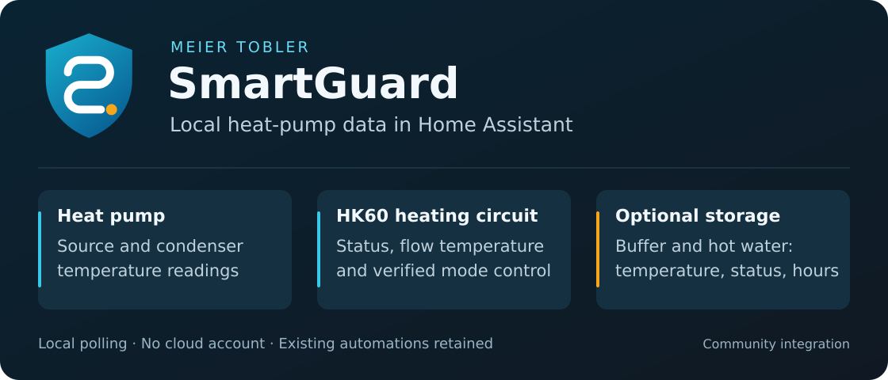

# Meier Tobler SmartGuard

Connect **Meier Tobler SmartGuard 2.0** to **Home Assistant** over your local
network. Monitor your heat pump and storage temperatures, and select the
operating mode of the HK60 heating circuit. No cloud account is needed.

The graphic is an illustrative feature overview, not a live installation screenshot.

## What you get

- **Heat pump:** source inlet and condenser inlet/outlet temperatures.
- **HK60:** actual and requested flow temperature, operating status,
  selected/effective mode and season. Optional room targets, outdoor
  thresholds, design outdoor temperature and damping durations are read-only
  displays of controller settings.
- **Configured names:** keep short measurement-first names and show circuit/storage
  assignments separately; diagnostic label sensors show the configured labels.
  Numeric readings and mode control continue to cover HK60 only.
- **Controller:** outdoor temperature, Smart Grid status and three fault inputs.
- **Mode control:** Auto, Normal, Reduced, Frost protection, Heating and Cooling.
  Every write is immediately read back; an unconfirmed change reports an error.
- **Optional storage:** heating-buffer and hot-water temperatures, reported
  heater indicators, diagnostic operating-hour counters and buffer heat request.
- **Local operation:** one coordinated poll every 60 seconds, UI setup,
  gateway-address reconfiguration, actionable configuration repairs and redacted
  diagnostics.

The latest stable release is **[0.7.1](https://github.com/martins-netizen/ha-meiertobler-smartguard/releases/tag/v0.7.1)**,
published on 2026-11-02. Prefer the existing **HACS** entry for installation
and updates. With every supported module and reading available, it provides
**32 numeric/enum/timestamp sensors, six diagnostic label sensors, six binary
sensors and one mode select** (45 entities).

Heater indicators and heat requests report gateway status; they do not measure
electrical power or energy. This integration adds no heater controls or editable
temperature setpoints. See the [operating readings guide](docs/OPERATING_READINGS.md)
and [HK60 target and limits guide](docs/HK60_FLOW_AND_LIMITS.md) for availability,
configured names and interpretation.

## New in 0.7.1

Version 0.7.1 fixes prefilled dates in the native holiday editor and adds the
integration catalogue category. It was published on **2026-11-02**. Update the
existing HACS entry and restart Home Assistant; keep the existing config entry
and entity IDs. See the [0.7.1 release notes](docs/RELEASE_NOTES_0.7.1.md).

The maintainer's separate field report on 2026-11-03 confirms HACS installed
and latest versions of 0.7.1. Physical holiday operation remains a separate
acceptance step.

## New in 0.7.0

Version 0.7.0 adds shorter HK60 measurement names, four read-only
[heating-curve diagnostics](docs/HK60_HEATING_CURVE.md), two holiday timestamp
sensors and a guided [holiday period editor](docs/HOLIDAY_MODE_PLAN.md).
With all supported modules and readings available, it provides **32
numeric/enum/timestamp sensors, six label sensors, six binary sensors and one
mode select** (45 entities), using up to 44 GETs per refresh.

The editor shows the previous, requested and temporary intermediate periods
and requires explicit confirmation. It reads both dates back and stops after
partial or uncertain results without automatic retry or blind rollback.
Physical holiday operation still needs acceptance; the lighting presence
simulation and >24-hour absence suggestion remain separate HA work.

The annotated tag, tagged Release Gate and both release assets are verified.
See the [0.7.0 release notes](docs/RELEASE_NOTES_0.7.0.md) for scope, integrity
and separate live holiday acceptance. Existing entity IDs,
custom names and automations are preserved.

## Installation

### New installation with HACS

1. Open **HACS** and search for **Meier Tobler SmartGuard**.
2. Download the latest stable release and restart Home Assistant.
3. Open **Settings → Devices & services → Add integration**.
4. Select **Meier Tobler SmartGuard** and enter the gateway hostname or IP address.

Enter the host only, without a URL scheme, port, path or credentials.
The integration is included in the default HACS catalogue.

### Update an existing installation

1. Open the existing **Meier Tobler SmartGuard** HACS entry and select **Update**.
2. Restart Home Assistant, then check that your entities are available.

Keep the existing integration and config entry. Your entity IDs, settings and
automations are retained. If HACS does not show an available release, use
**Update information** and check again.

See the [installation guide](docs/INSTALLATION.md) for custom-repository and
manual installation, rollback and removal.

### Holiday period editor

A guided **Configure** dialog edits the complete HK60 holiday period, with a
concrete warning and explicit confirmation before any write. The two dates are
read back; partial or unknown outcomes stop without automatic retry or rollback.
The editor was introduced in 0.7.0; version 0.7.1 fixes date prefilling.
Physical holiday operation still needs separate acceptance; lighting presence
simulation is configured separately in Home Assistant.
See [the holiday contract and plan](docs/HOLIDAY_MODE_PLAN.md).

## Compatibility and security

- **Home Assistant 2026.9.0 or newer.**
- **SmartGuard 2.0, device type `1001`.** HK60 must be enabled for its entities.
- Storage and additional operating readings are optional. Unsupported or
  unavailable optional readings do not block the original entities.
- **Trusted local network required:** the gateway REST API uses unauthenticated
  HTTP. Its UI password does not secure this API. Restrict gateway access to
  Home Assistant and never expose the API to the internet.

This is an independent community integration, not affiliated with or endorsed
by Meier Tobler AG. See the [security policy](SECURITY.md).

## Guides and support

- [Installation, updates and recovery](docs/INSTALLATION.md)
- [Troubleshooting](docs/TROUBLESHOOTING.md)
- [Guarded automation examples](docs/AUTOMATION_EXAMPLES.md)
- [Blueprint and quality evidence review](docs/QUALITY_REVIEW.md)
- [Additional storage measurements](docs/ADDITIONAL_MEASUREMENTS.md)
- [Additional read-only operating readings](docs/OPERATING_READINGS.md)
- [HK60 heating-curve diagnostics](docs/HK60_HEATING_CURVE.md)
- [Holiday period editor and presence-simulation plan](docs/HOLIDAY_MODE_PLAN.md)
- [Technical reference and development checks](docs/TECHNICAL_REFERENCE.md)
- [Report a bug](https://github.com/martins-netizen/ha-meiertobler-smartguard/issues/new/choose)

Review diagnostics before sharing them. Keep hostnames, device identifiers and
raw installation data out of public issues; report security problems privately.

## Releases and verification

Use [GitHub Releases](https://github.com/martins-netizen/ha-meiertobler-smartguard/releases/latest)
for available downloads and the [changelog](CHANGELOG.md) for changes.
Preparation and publication evidence live in the
[release checklist](docs/RELEASE_CHECKLIST.md), away from the installation steps.

- Release notes: [0.7.1](docs/RELEASE_NOTES_0.7.1.md),
  [0.7.0](docs/RELEASE_NOTES_0.7.0.md),
  [0.6.0](docs/RELEASE_NOTES_0.6.0.md),
  [0.5.0](docs/RELEASE_NOTES_0.5.0.md),
  [0.4.1](docs/RELEASE_NOTES_0.4.1.md),
  [0.4.0](docs/RELEASE_NOTES_0.4.0.md), [0.3.0](docs/RELEASE_NOTES_0.3.0.md).
- HACS records: [0.4.0 upgrade](docs/HACS_TEST_V0.4.0.md),
  [0.3.0 installation](docs/HACS_TEST_V0.3.0.md).

## Deutsch – kurz erklärt

Diese lokale Integration verbindet **Meier Tobler SmartGuard 2.0** mit
**Home Assistant**. Sie zeigt Wärmepumpen- und HK60-Werte sowie optional die
Temperaturen und gemeldeten Heizeinsatzwerte von Heizpuffer und Warmwasser.
Weitere optionale Anzeigen umfassen Vorlauf SOLL und IST, Raum-Sollwerte,
Heiz-/Kühlschwellen, Dämpfungszeiten, Aussentemperatur, Smart-Grid-Status,
Störsignale und Heizpuffer-Heizanforderung. Konfigurierte Modulbezeichnungen
machen die Anzeigen verständlicher; bestehende Entity-IDs bleiben erhalten. Sollwerte werden
nur angezeigt; sie sind hier nicht einstellbar.
Die HK60-Betriebsmoduswahl wird nach jeder Änderung unmittelbar zurückgelesen.
Heizeinsatz-Anzeigen sind keine elektrische Leistungs- oder Energiemessung.

**Installation:** In HACS nach **Meier Tobler SmartGuard** suchen, die aktuelle
stabile Version herunterladen und Home Assistant neu starten. Bei der ersten
Installation die Integration unter **Einstellungen → Geräte & Dienste**
hinzufügen. Bei einem Update bleibt die bestehende Einrichtung erhalten.
Benötigt werden SmartGuard-Gerätetyp `1001` und Home Assistant **ab 2026.9.0**.
Die ungeschützte lokale HTTP-API gehört ausschliesslich in ein vertrauenswürdiges
lokales Netzwerk. Unabhängiges Community-Projekt ohne Herstellerunterstützung.
